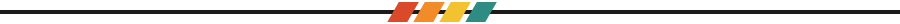

<div align="center">
  
</div>

<br>

```text
┌───────────────────────────────────────────────┐
│  about_me.txt                                 │
├───────────────────────────────────────────────┤
│  name ......... Thomas Fuhriman               │
│  role ......... Full stack developer          │
│  school ....... Boise CodeWorks (graduate)    │
│  learning ..... React, Angular, Flutter       │
└───────────────────────────────────────────────┘
```

I'm a full stack developer and a graduate of Boise CodeWorks. I've always liked the hard puzzles that come with building applications, and I'm still amazed by what you can make by combining different languages and frameworks. I'm always picking up something new, so feel free to reach out on LinkedIn.



## 01 / Tech I use

<p align="left">
  
  
  
  
  
  
  
  
  
</p>

## 02 / Currently learning

<p align="left">
  
  
  
  
  
</p>


## 03 / Activity

<div align="center">
  
</div>


## 04 / Contact

<p align="left">
  <a href="https://www.linkedin.com/in/thomas-fuhriman/">
    
  </a>
  <a href="https://github.com/ThomF">
    
  </a>
</p>

<div align="center">
  <sub>Thanks for stopping by!</sub>
</div>
